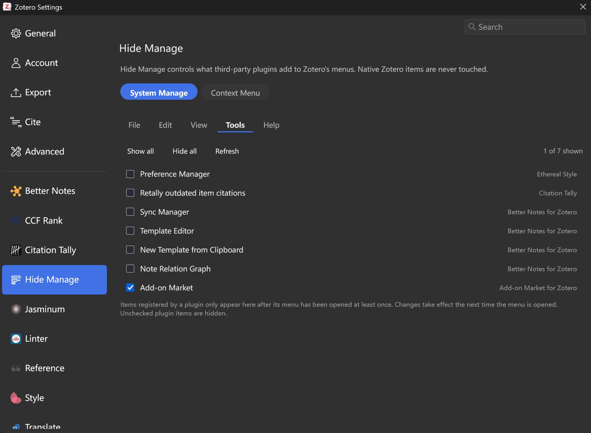
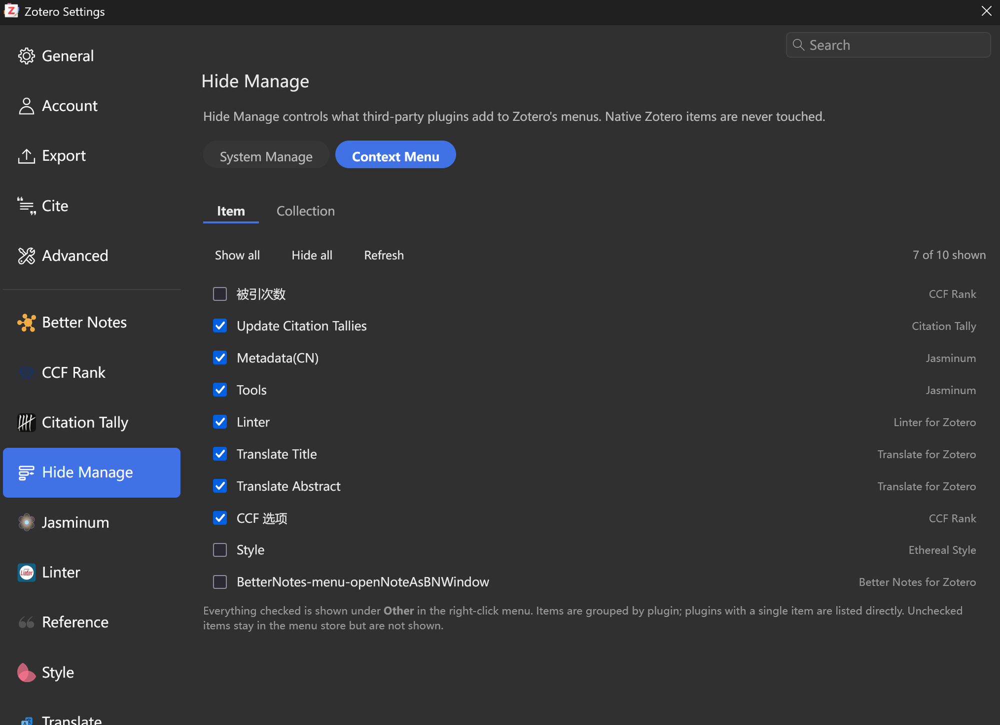
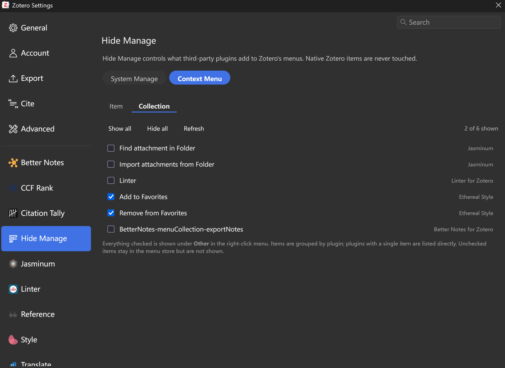
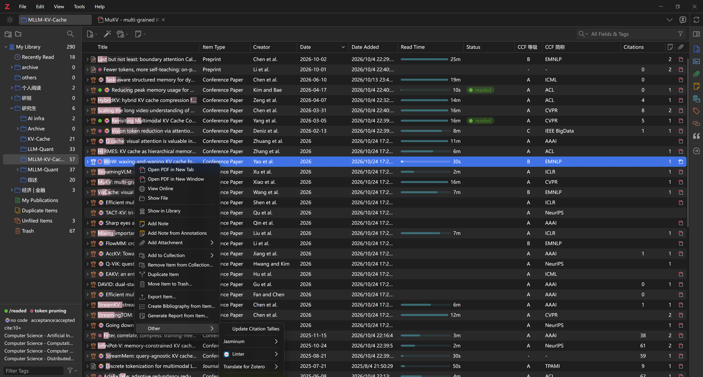
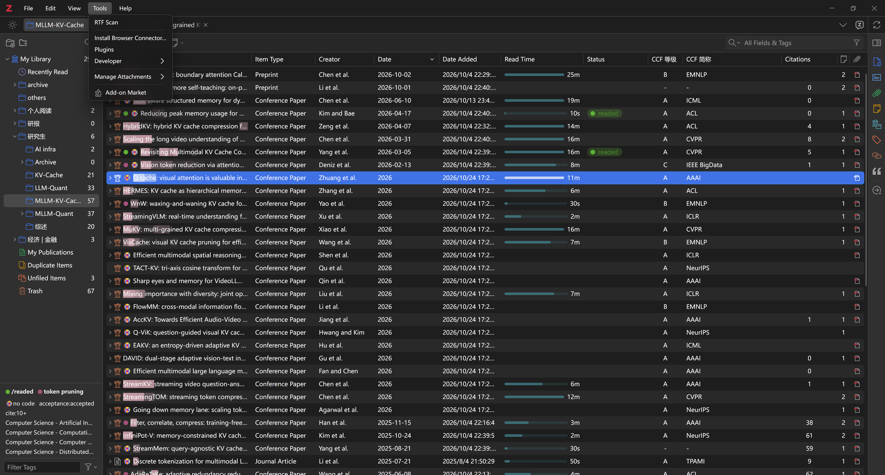

# Hide Manage for Zotero

**Native features stay untouched. Every third-party menu item answers to you.**

English | [简体中文](README.zh-CN.md)

[](https://github.com/ActiveSky/zotero-hide-manage/releases)
[](LICENSE)
[](https://www.zotero.org)

---

## Why this plugin

Zotero's plugin ecosystem is great, but every plugin adds its own entries to the menus: an export template at the bottom of File, a sync manager, template editor and add-on market in Tools, and a context menu that no longer fits on one screen. Install ten plugins and the operations that actually belong to Zotero become hard to find.

Existing solutions (such as the menu manager built into Ethereal Style) have two problems. First, they only cover the item and collection context menus, not the menu bar. Second, they work by matching label text and reordering entries, so they break as soon as a plugin changes its wording, and they tend to conflict with Zotero's own menu construction, producing entries out of order.

Hide Manage takes a different approach: **collect, never reorder; touch third-party items, never native ones.**

## Screenshots

### Settings pane

**System Manage — third-party items in the Tools menu are hidden until you tick them**



**Context Menu — Item tab: pick what appears under Other**



**Context Menu — Collection tab**



### In Zotero

**Item context menu — every third-party entry is collected under Other**



**Tools menu — only the ticked Add-on Market appears; native items stay untouched**



## Features

### System Manage — menu bar

- Covers all five menus: **File / Edit / View / Tools / Help**
- Every third-party item is **hidden by default**; only what you tick in the settings pane appears
- Native Zotero items are never hidden or moved
- One tab per menu makes the list easy to scan and tick
- Changes apply immediately — reopen the menu to see them

### Context Menu — right-click menus

- Covers the **item** and **collection** context menus
- Every third-party item is collected into a single top-level **Other** submenu, grouped by plugin
  (`Other ▸ Better Notes for Zotero ▸ Sync Manager`)
- One entry instead of dozens: the top level of the menu is clean again
- Tick individual items in the settings pane; unticked items are hidden completely
- A single-item plugin is shown flat, with no extra submenu wrapper

### Design principles

| Principle | What it means |
|---|---|
| **Native first** | Native items are identified by Zotero's own class markers and id whitelists, and are never touched |
| **Fully reversible** | Only the `hidden` attribute is set and DOM nodes are moved. Nothing is deleted; uninstalling restores everything |
| **Exact ownership** | Items registered through MenuManager are attributed by their official pluginID, not guessed |
| **No reordering** | No custom sort order, so there is no timing conflict with Zotero's own menu construction |

## Installation

1. Download the latest `hide-manage.xpi` from [Releases](https://github.com/ActiveSky/zotero-hide-manage/releases)
2. In Zotero: Tools → Plugins → gear icon (top right) → **Install Plugin From File**
3. Restart, then open Settings → **Hide Manage**

Supports Zotero 8 – 11.

## Usage

### Settings pane

Settings → Hide Manage has two top-level categories:

- **System Manage**: five menu tabs. Tick the third-party items you want to show.
- **Context Menu**: Item / Collection tabs. Tick the items that should appear under Other.

Every tab has **Show all / Hide all / Refresh**. The right side of each row shows which plugin the item comes from.

> Items registered dynamically by a plugin only appear in the list after that menu has been opened once and you click **Refresh**.

### Default behaviour

- Menu bar: all third-party items are hidden by default (whitelist model)
- Context menu: all third-party items are shown by default, but collected under Other (blacklist model)

## Preferences

Advanced preferences live in Zotero's Config Editor (Settings → Advanced → Config Editor), prefixed with `extensions.zotero.menuhider.`:

| Key | Type | Default | Description |
|---|---|---|---|
| `showOnly` | bool | `true` | Whether the menu bar uses "show only ticked items" |
| `show` | JSON string | `{}` | Menu bar whitelist, e.g. `{"tools":["l10n:..."]}` |
| `contextHidden` | JSON string | `{}` | Context menu blacklist, e.g. `{"item":["id:..."]}` |
| `groupMenus` | bool | `true` | Whether to collect context menu items under Other |
| `groupLabel` | string | `"Other"` | Label of the collection submenu |
| `minGroupSize` | int | `2` | Minimum items before a plugin gets its own submenu |
| `rules` | JSON string | `{}` | Forced hide rules (can target native items) |
| `legacyGroups` | JSON string | see defaults | legacy id/l10n prefix → plugin display name |
| `nativeIds` | JSON array | `[]` | Force items to be treated as native, e.g. `["id:foo","l10n:bar"]` |
| `scan` | bool | `true` | Write the menu inventory to `<data dir>/menuhider-inventory.json` when a menu opens |

Rule keys accept four prefixes: `id:`, `l10n:`, `label:`, `plugin:`.

## How it works

Zotero 8+ provides an official `Zotero.MenuManager` registration API, but plugins can also append nodes to the DOM directly, so menu items come from two channels:

1. **Items registered through MenuManager**: the element carries a `zotero-custom-menu-item` class, and the class list includes `CSS.escape(pluginID-menuID)`, which tells you exactly which plugin it belongs to.
2. **Items injected the legacy way**: matched by `id`, `data-l10n-id`, or label text only.

Native item detection:
- Menu bar: a built-in whitelist of Zotero 10 native ids, plus `menu-type-*` classes and id prefixes.
- Context menus: native items all carry a `zotero-menuitem-*` class; a few exceptions (such as `addFeed`) are covered by an id whitelist.

When hiding is applied: after handling `popupshowing`, the rules are re-applied twice with a delay (0 ms and 60 ms). Some plugins reset `hidden` in their own `popupshowing` handler, and their listener may be registered after ours.

How collection works: on every context menu open, the previous Other container is dismantled, legacy nodes are moved back to their original position, stale MenuManager nodes are dropped, and the container is rebuilt from the current selection. This works around MenuManager's cleanup, which only removes direct children.

## Known limitations

- Only top-level items are handled; the inside of custom submenus is not touched
- Items registered through MenuManager only appear in the settings list after that menu has been opened once
- Mutually exclusive with Ethereal Style's "Menu Visibility Manager" — keep that feature disabled
- A Zotero major upgrade may add native items; if one is misclassified, add it to the `nativeIds` whitelist

## Development

No build dependencies; the source is the product. All plugin source lives in `src/`; the repository root only keeps docs, the build script and the update manifest.

```
src/
├── manifest.json              plugin manifest
├── bootstrap.js               main logic (hiding, collection, lifecycle)
├── prefs.js                   default preferences
└── content/
    ├── preferences.xhtml      settings pane markup
    ├── preferences.js         settings pane logic
    └── icon.svg               settings pane icon
build.ps1                      build script
update.json                    auto-update manifest
```

Build:

```powershell
pwsh ./build.ps1
```

The script puts the contents of `src/` at the root of the XPI (Zotero requires `manifest.json` at the package root) and writes `hide-manage.xpi`.

Debugging: open Zotero's Tools → Developer → Run JavaScript; `Zotero.MenuHider` is available there. Logs are in Help → Debug Output Logging.

## License

[MIT](LICENSE) © 2026 Jikui Xie (ActiveSky)
