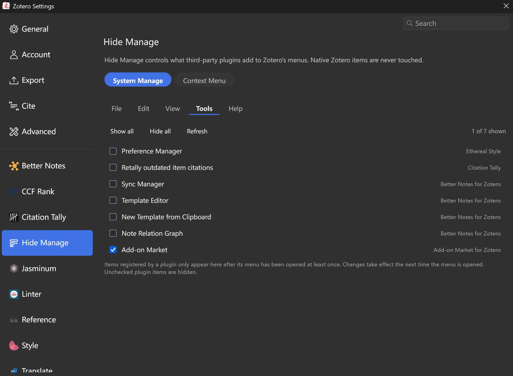
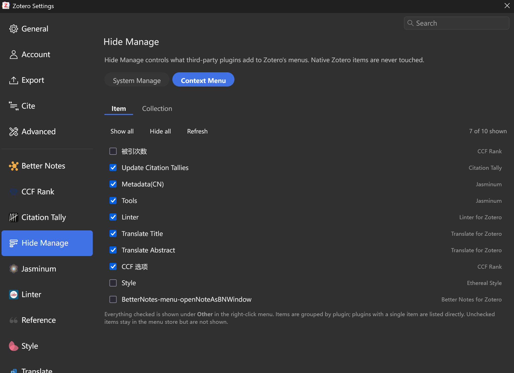
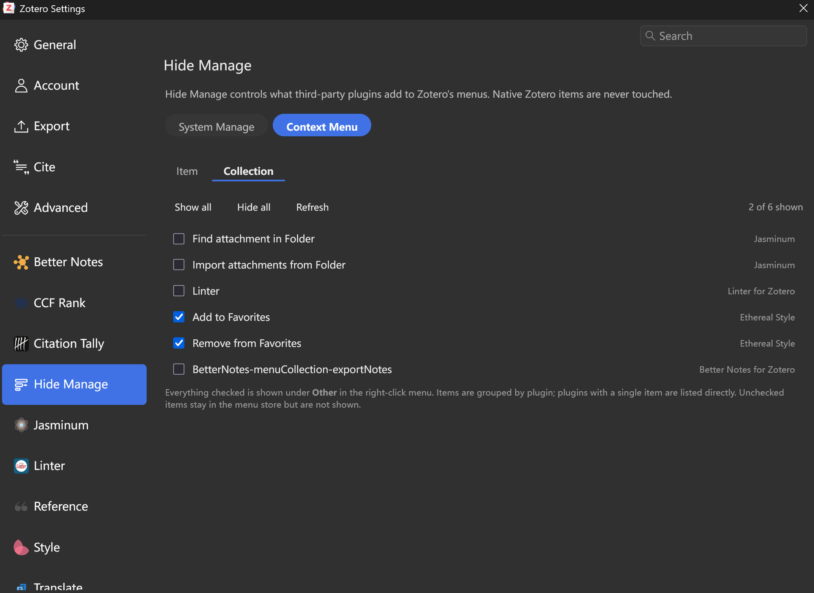

# Hide Manage — Zotero 菜单管理器

**原生功能一个不动，第三方插件注入的菜单项统一归你管。**

[English](README.md) | 简体中文

[](https://github.com/ActiveSky/zotero-hide-manage/releases)
[](LICENSE)
[](https://www.zotero.org)

---

## 为什么做这个插件

Zotero 的插件生态很好，但每个插件都往菜单里塞东西：File 底部多一行导出模板，Tools 里堆着同步管理器、模板编辑器、插件市场，右键菜单更是一屏放不下。装十个插件之后，真正属于 Zotero 的操作反而找不到了。

已有的方案（比如 Ethereal Style 内置的菜单管理器）有两个问题：一是只覆盖条目/分类右键，菜单栏管不到；二是靠标签文本匹配和重排实现，插件一改文案规则就失效，还容易和 Zotero 自身的菜单构建打架，出现顺序错乱。

Hide Manage 换了个思路：**只做收纳，不做重排；只碰第三方项，不碰原生项。**

## 界面截图

**System Manage — Tools 菜单里的第三方项，只有勾选的才显示**



**Context Menu — Item 标签页：勾选要出现在 Other 里的项**



**Context Menu — Collection 标签页**



## 特性

### System Manage — 菜单栏

- 覆盖 **File / Edit / View / Tools / Help** 五个菜单
- 所有第三方插件注入的项**默认隐藏**，只有你在设置里勾选的才显示
- Zotero 原生项永远不会被隐藏或移动
- 设置页按菜单分标签页，一目了然地勾选
- 改完立即生效，下次展开菜单即可看到

### Context Menu — 右键菜单

- 覆盖 **条目** 和 **分类** 两个右键菜单
- 所有第三方项收进一个顶级 **Other** 子菜单，按插件分组
  （`Other ▸ Better Notes for Zotero ▸ Sync Manager`）
- 只出现一个入口，菜单顶层重新变得清爽
- 设置页可以逐项勾选，未勾选的项彻底隐藏
- 单项插件直接平铺，不会为一项多套一层子菜单

### 设计原则

| 原则 | 说明 |
|---|---|
| **原生优先** | 原生项由 Zotero 自己的 class 标记和 id 白名单识别，永不触碰 |
| **完全可逆** | 只设置 `hidden` 和移动 DOM 节点，不删除任何东西；卸载插件即恢复 |
| **精确归属** | MenuManager 注册的项通过官方 pluginID 精确识别，不靠猜 |
| **不重排** | 不做自定义排序，避免和 Zotero 的菜单构建时序冲突 |

## 安装

1. 从 [Releases](https://github.com/ActiveSky/zotero-hide-manage/releases) 下载最新 `hide-manage.xpi`
2. Zotero → 工具 → 插件 → 右上角齿轮 → **Install Plugin From File**
3. 重启后进入 设置 → **Hide Manage**

支持 Zotero 8 – 11。

## 使用

### 设置页

设置 → Hide Manage，顶部有两个大类：

- **System Manage**：五个菜单标签页，勾选要显示的第三方项
- **Context Menu**：Item / Collection 两个标签页，勾选要出现在 Other 里的项

每个标签页都有 **Show all / Hide all / Refresh**。列表右侧会标注该项来自哪个插件。

> 由插件动态注册的菜单项，需要先展开一次对应菜单，再点 **Refresh** 才会出现在列表里。

### 默认行为

- 菜单栏：第三方项默认全部隐藏（白名单模型）
- 右键菜单：第三方项默认全部显示，但都收在 Other 里（黑名单模型）

## 配置项

高级配置在 Zotero 的配置编辑器（设置 → 高级 → 配置编辑器）中，前缀 `extensions.zotero.menuhider.`：

| 键 | 类型 | 默认 | 说明 |
|---|---|---|---|
| `showOnly` | bool | `true` | 菜单栏是否启用"仅显示勾选项" |
| `show` | JSON string | `{}` | 菜单栏白名单，形如 `{"tools":["l10n:..."]}` |
| `contextHidden` | JSON string | `{}` | 右键菜单黑名单，形如 `{"item":["id:..."]}` |
| `groupMenus` | bool | `true` | 是否启用右键菜单收纳 |
| `groupLabel` | string | `"Other"` | 收纳子菜单的顶层名称 |
| `minGroupSize` | int | `2` | 达到多少项才为插件单独建子菜单 |
| `rules` | JSON string | `{}` | 强制隐藏规则（可作用于原生项） |
| `legacyGroups` | JSON string | 见默认值 | legacy 项的 id/l10n 前缀 → 插件显示名 |
| `nativeIds` | JSON array | `[]` | 强制视为原生项，形如 `["id:foo","l10n:bar"]` |
| `scan` | bool | `true` | 展开菜单时把清单写入 `<数据目录>/menuhider-inventory.json` |

规则键支持四种前缀：`id:`、`l10n:`、`label:`、`plugin:`。

## 工作原理

Zotero 8+ 提供了官方的 `Zotero.MenuManager` 注册 API，但插件也能直接往 DOM 里 `appendChild`，所以菜单里有两条来源通道：

1. **MenuManager 注册的项**：元素带 `zotero-custom-menu-item` class，class 里还包含 `CSS.escape(pluginID-menuID)`，可以反查是哪个插件
2. **legacy 注入的项**：只能按 `id` / `data-l10n-id` / 标签文本匹配

原生项的识别：
- 菜单栏：内置 Zotero 10 的原生 id 白名单，加上 `menu-type-*` class 和 id 前缀判断
- 右键菜单：原生项统一带 `zotero-menuitem-*` class，个别例外（如 `addFeed`）用 id 白名单补上

隐藏时机：在 `popupshowing` 中处理完毕后，再延迟两次（0ms / 60ms）重新应用。这是因为部分插件会在自己的 `popupshowing` 处理器里把 `hidden` 重置掉，而它们的监听器可能注册得比我们晚。

收纳实现：每次展开右键菜单时先拆掉上一次生成的 Other，把 legacy 节点放回原位，丢弃 MenuManager 的过期节点，然后重新按当前勾选状态构建。这避开了 MenuManager 只清理直接子元素的机制限制。

## 已知限制

- 只处理菜单的顶层项，不递归自定义子菜单内部
- MenuManager 注册的项需要先展开过一次菜单，才会出现在设置列表里
- 与 Ethereal Style 的「菜单可见性管理」功能互斥，请保持后者关闭
- Zotero 大版本升级可能新增原生项，若被误判可用 `nativeIds` 手动加入白名单

## 开发

无构建依赖，源码即产物。所有插件源码都在 `src/`，仓库根目录只保留文档、构建脚本和更新清单。

```
src/
├── manifest.json              插件清单
├── bootstrap.js               主逻辑（菜单隐藏、收纳、生命周期）
├── prefs.js                   默认配置
└── content/
    ├── preferences.xhtml      设置页结构
    ├── preferences.js         设置页逻辑
    └── icon.svg               设置页图标
build.ps1                      打包脚本
update.json                    自动更新清单
```

打包：

```powershell
pwsh ./build.ps1
```

脚本会把 `src/` 的内容放到 XPI 根目录（Zotero 要求 `manifest.json` 位于包根），产物为 `hide-manage.xpi`。

调试：Zotero 的「工具 → 开发者 → 运行 JavaScript」中可以访问 `Zotero.MenuHider`，或查看「帮助 → 调试输出日志」。

## 许可证

[MIT](LICENSE) © 2026 Jikui Xie (ActiveSky)
